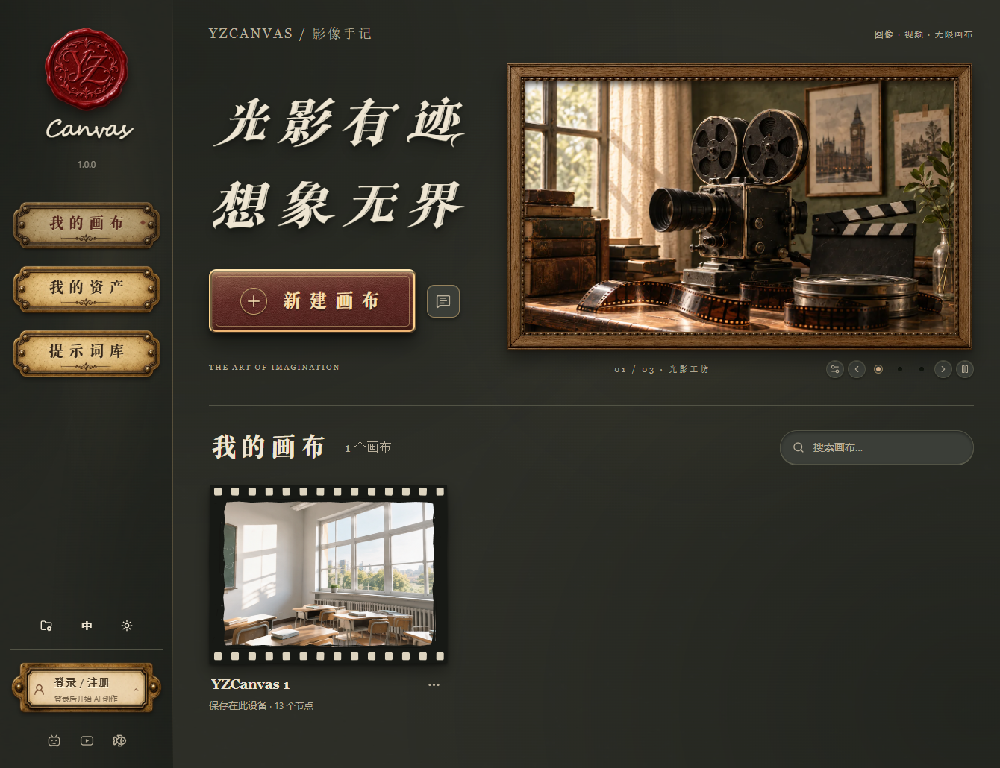
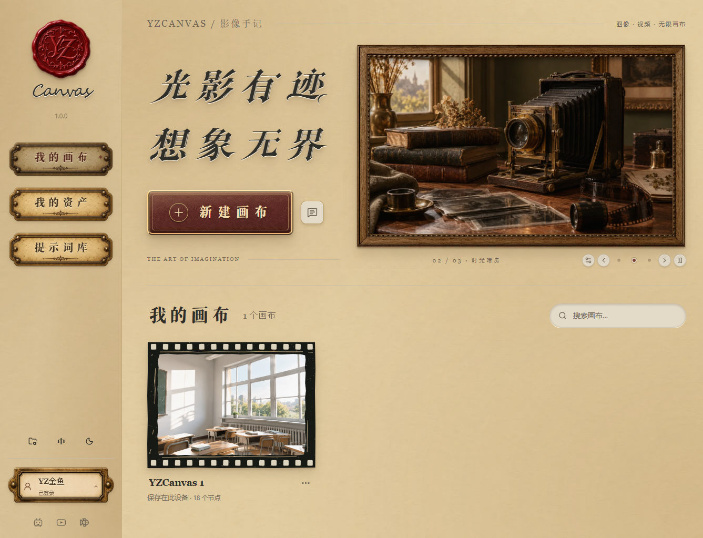
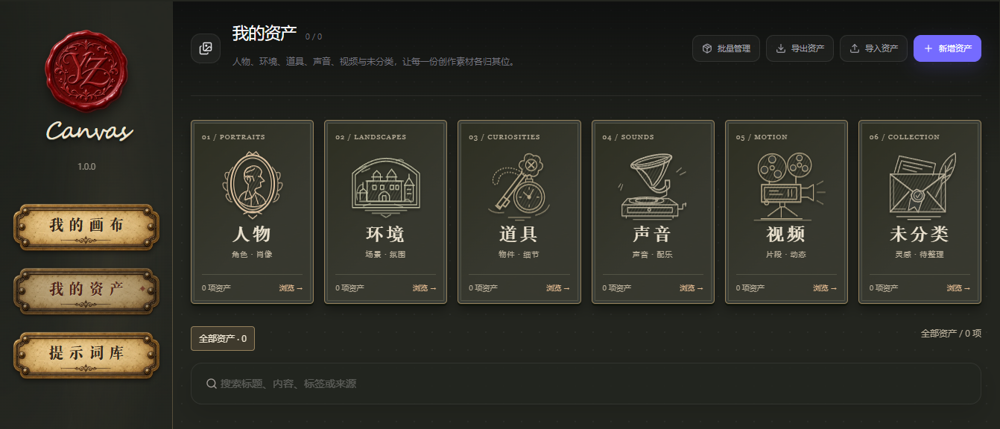
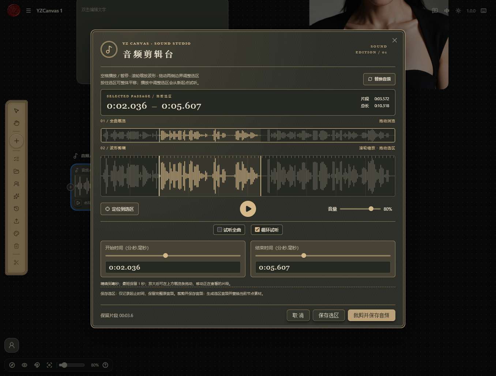
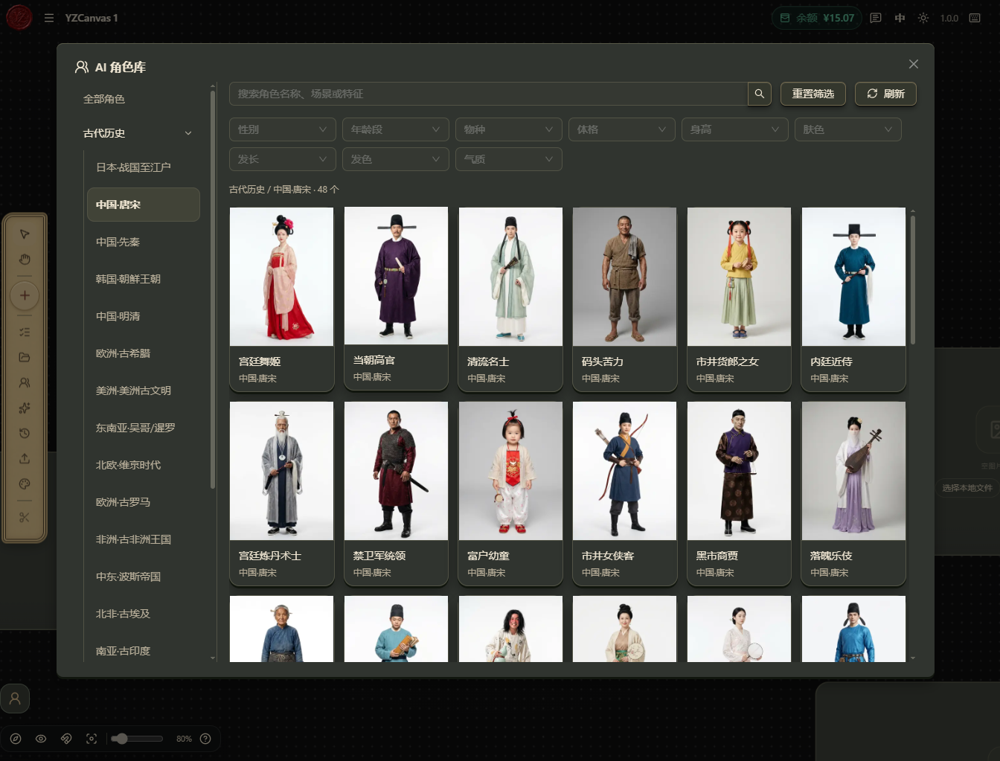
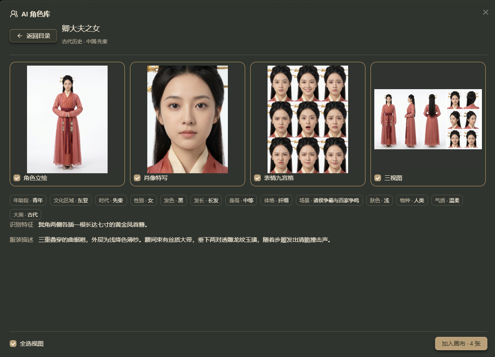
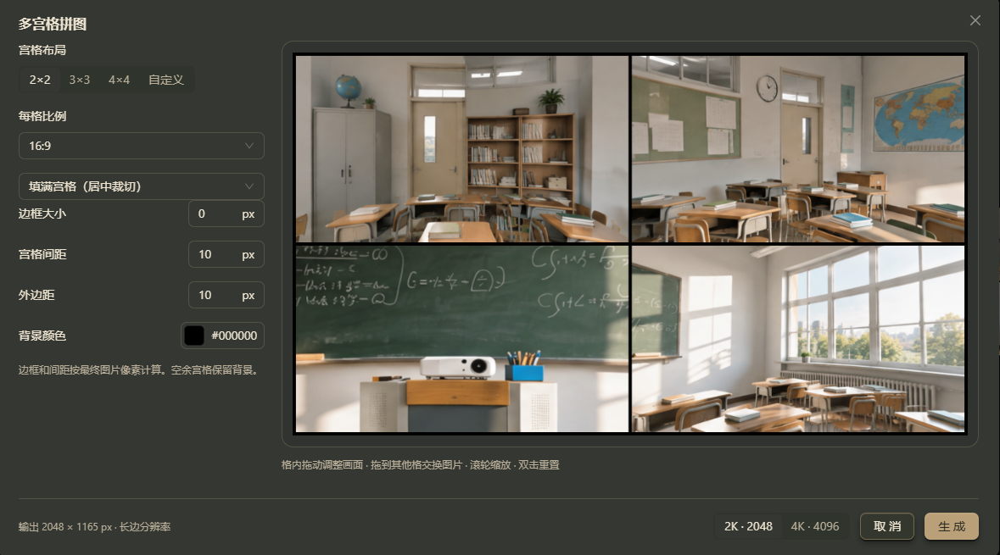
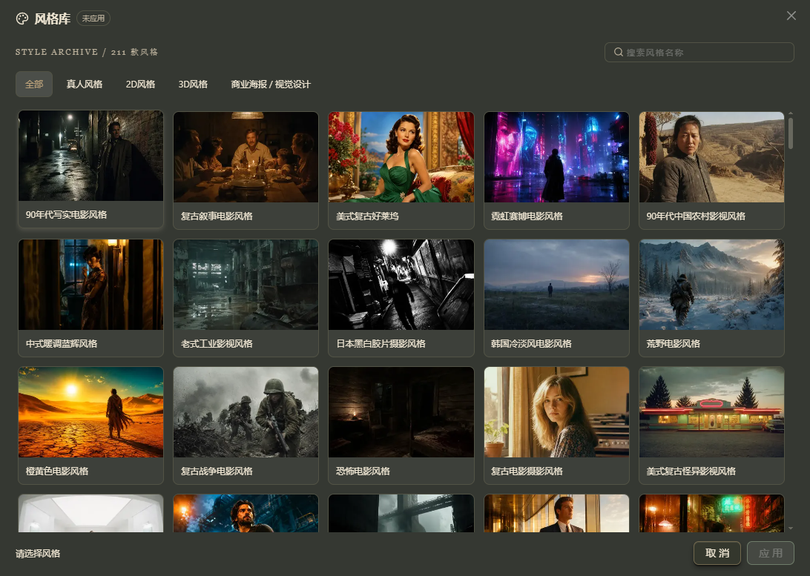

  

<h1 align="center">YZ-Ai-Studio</h1>

## YZCanvas · AI 无限画布

Windows 客户端发布、版本更新与使用说明。

### 当前版本：1.0.2

- [下载 Windows x64 安装包](https://github.com/YZ1989/YZ-Ai-Studio/releases/download/v1.0.2/YZCanvas_1.0.2_x64-setup.exe)
- [国内下载](https://downloads.yz-jinyu.cn/updates/YZCanvas_1.0.2_x64-setup.exe)
- [最新版本与历史安装包](https://github.com/YZ1989/YZ-Ai-Studio/releases)
- [版本更新记录](CHANGELOG.md)

## 获取更新

已接通在线更新的客户端可打开版本窗口，检查更新并下载安装。旧版也可下载完整安装包进行更新。本仓库提供 Windows x64 完整安装包，不是增量补丁。

安装前请保存工程，完成或停止正在运行的生成任务，并备份整个 Workspace 文件夹。工程管理支持选择并恢复原工程目录；重装系统前请保留该目录。

## 核心功能

- 无限画布：组织文本、图像、音频、视频与参考连线。
- 图像与视频生成，节点生成历史与版本切换。
- 金鱼AI 角色库、多视图预览及加入画布。
- 资产管理、提示词库与本地工程管理。

## 产品展示

以英伦复古风格打造的 AI 创作工作台，将画布、素材和创作工具汇集在一起。以下为 YZCanvas 1.0.0 客户端实机截图，点击图片可查看大图。

### 首页 · 深浅双主题

火漆印章、复古相框与胶片式画布卡片，搭配暗色和亮色主题。从首页即可进入画布、资产管理与提示词库。

### 资产管理

按人物、环境、道具、声音、视频等分类整理素材，支持搜索、新建、批量管理及导入导出，让常用资产随时可用。

### 音频剪辑台

直接在画布中查看音频波形，缩放选区、调整起止时间并循环试听，可保存选区或裁剪音频。

### AI 角色库

按时代、文化区域与角色特征查找参考人物，预览角色立绘、肖像特写、表情九宫格和三视图，并将选中的视图加入画布。

### 多宫格拼图

提供 2×2、3×3、4×4 及自定义布局，可调整比例、间距和背景，在预览中拖动、缩放与交换图片，生成 2K 或 4K 拼图。

### 摄影机预设

组合相机、镜头、焦距与光圈设置，浏览影像特征参考，为 AI 创作选择合适的镜头语言。

### 风格库

浏览真人、2D、3D、商业海报与视觉设计等风格，通过示例图快速选择创作方向，也可按名称搜索。

## 本次更新

- [新增] RunningHub 应用窗口支持保存应用、收藏筛选、六项排序及右键多选批量删除，右键空白处可清空选择并退出多选。

- [优化] 应用搜索与添加共用自动识别输入框；应用卡片与画布封面完整显示 3:4 图片，名称及黄色收藏星标悬停显示，站点标签移至左下角，顶部星标与多选框对齐。

- [新增] RunningHub 素材集中到可独立移动、横纵调整大小的收纳面板，保留图片编辑、音频剪辑和画布引用；接入接口仅在拉线时显示，汇总线从面板中部连接应用。

- [优化] 素材面板与外部画布引用支持双向高亮，仅强调当前素材及其实际接入连线，加强缩小画布时的描边，减少无关连线干扰。

- [优化] RunningHub 应用节点打开即展示参数，精简操作区并分区排列计费、生成和任务恢复；生成旁可选择应用支持的运行模式，提交前重新校验。

- [修复] RunningHub 应用未返回运行模式时交由服务端处理，避免误拦截生成；支持海外站带语言前缀的应用网址。

- [调整] 账户与服务设置重新开放 RunningHub 国内站和海外站 API Key 配置，画布配置入口可直接展开对应站点。

- [调整] 画布节点素材与批量 ZIP 下载改为先选择保存位置和文件名，取消时结束操作，保存成功后再显示完成提示。

- [新增] 图像节点接入 Nano Banana 2.1 普通版与低价版，同步分辨率、比例、参考图和提示词限制，并优先使用后台固定价表。

## 帮助与反馈

在客户端首页或画布右上角打开「问题反馈」，可以提交问题、查看处理状态与回复。

[金鱼AI](https://api.yz-jinyu.com/) · [作者 B站](https://space.bilibili.com/14843708) · [作者 YouTube](https://www.youtube.com/@jinyuze123)

## 仓库范围与许可

本仓库用于分发客户端安装包、更新签名、校验值与版本说明，不包含开发工作区、用户素材、账号凭据或签名私钥。

客户端包含的上游代码继续适用 AGPL-3.0；发布仓库不改变原许可证及相关权利，许可证见 [LICENSE](LICENSE)。

## 开源许可与来源

YZCanvas 基于 [`basketikun/infinite-canvas`](https://github.com/basketikun/infinite-canvas) 开源项目进行二次开发。
